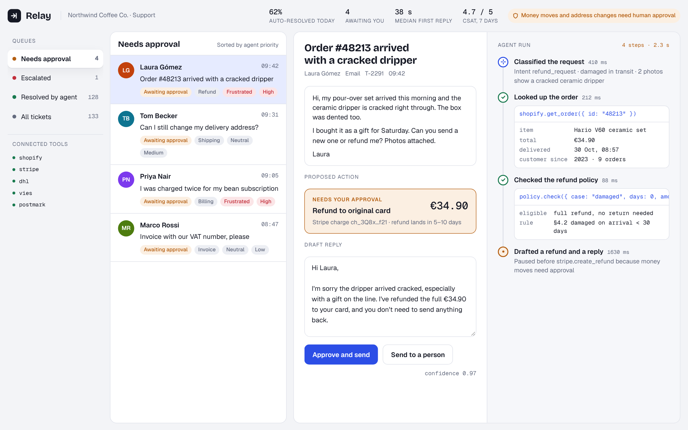

# Relay

An AI support inbox. A Claude agent reads each customer ticket, looks things up in the shop's systems, and drafts the reply. Anything that moves money or changes an order waits for a person to approve it.

Built for a fictional shop, Northwind Coffee Co.



## What it shows

- **Agent loop with tool use.** Spring Boot calls Claude through the official Anthropic Java SDK and runs the tool loop itself: 12 tools, strict JSON schemas, adaptive thinking, prompt caching on the system prompt, and server-side fallback if a request is declined.
- **Human approval gate.** `issue_refund`, `update_shipping_address` and `send_invoice` never run when the agent calls them. They are validated (does the charge belong to this customer, is the amount within the charge and the €200 agent limit, has the parcel left), then stored as pending actions. They run only when a person clicks **Approve and send**.
- **Live timeline.** Every reasoning summary and tool call is stored and pushed to the browser over server-sent events, so you watch the agent work.
- **Escalation.** Liability claims, amounts over policy, or low confidence go to a person with a summary instead of a reply.
- **Runs without a key.** With no `ANTHROPIC_API_KEY`, a rule-based agent goes through the same tools and gate, so the demo and the tests work offline.

## Run it

```bash
# H2 in memory, scripted agent
mvn spring-boot:run

# Claude works the tickets
ANTHROPIC_API_KEY=sk-ant-... mvn spring-boot:run

# Postgres + app in Docker (fill in .env first)
cp .env.example .env
docker compose up --build
```

Open http://localhost:8080 and sign in as `operator`. Locally, without `RELAY_OPERATOR_PASSWORD`, a one-off password is printed in the startup log. Six sample tickets are worked on startup. Use **Simulate email** to send a new one and watch the run.

| Variable | Default | |
|---|---|---|
| `ANTHROPIC_API_KEY` | unset | Set it to use Claude; unset uses the scripted agent |
| `RELAY_AGENT_MODE` | `auto` | `claude`, `scripted` or `auto` |
| `RELAY_MODEL` | `claude-opus-5-5` | Any Claude model id |
| `RELAY_EFFORT` | `medium` | `low` to `max` |
| `RELAY_SEED` | `true` | Load the sample tickets into an empty inbox |
| `RELAY_OPERATOR_USER` | `operator` | Operator login |
| `RELAY_OPERATOR_PASSWORD` | random, logged | Operator password; always set it outside your machine |
| `DB_PASSWORD` | none | Postgres password for the `postgres` profile |

## API

| Method | Path | |
|---|---|---|
| `GET` | `/api/tickets?status=AWAITING_APPROVAL` | List tickets |
| `GET` | `/api/tickets/{id}` | Ticket with its agent steps and queued actions |
| `POST` | `/api/tickets` | New inbound ticket; the agent starts on it at once |
| `POST` | `/api/tickets/{id}/approve` | Run the queued actions and send the (edited) reply |
| `POST` | `/api/tickets/{id}/hand-over` | Cancel queued actions and give the ticket to a person |
| `POST` | `/api/tickets/{id}/rerun` | Clear the run and let the agent try again |
| `GET` | `/api/events` | Server-sent events for ticket and step changes |
| `GET` | `/api/stats` | Inbox numbers for the header |

## Security notes

- Every page and API call needs the operator login (HTTP Basic); only `/actuator/health` is open. State-changing calls also need the CSRF token from the `XSRF-TOKEN` cookie, and pages are served with a strict Content-Security-Policy.
- No secrets live in the repo. The API key, database password and operator password come from environment variables, a git-ignored `.env`, or a Kubernetes secret.
- Customer emails are untrusted input to the model. A message that tries to talk the agent into a refund still only queues it: the gate checks that the charge belongs to the ticket's customer, that the amount is within the charge and the €200 agent limit, and a person approves it.
- The store is an in-memory fake. Before connecting real Shopify or Stripe accounts, verify sender identity on inbound email (the gate trusts the ticket's email address) and replace HTTP Basic with your SSO.

## Layout

```
agent/   ClaudeTicketAgent (Messages API loop), ScriptedTicketAgent, SupportTools (tools + approval gate), AgentService
store/   CommerceStore: in-memory stand-in for Shopify, Stripe, DHL and VIES; RefundPolicy
ticket/  JPA entities: Ticket, AgentStep, PendingAction; live events
web/     REST controllers, intake, demo seeder
security/ operator login, CSRF, CSP
k8s/     Deployment + Service
```

## Tests

`mvn verify` runs 14 tests: the refund is queued and no money moves until approval, a duplicate charge refunds only the charge with no invoice, liability claims escalate with nothing queued, read-only answers go out on their own, a hand-over cancels queued actions, the guard refuses refunds on someone else's charge or over the charge amount, and the API rejects calls without a login or CSRF token.
